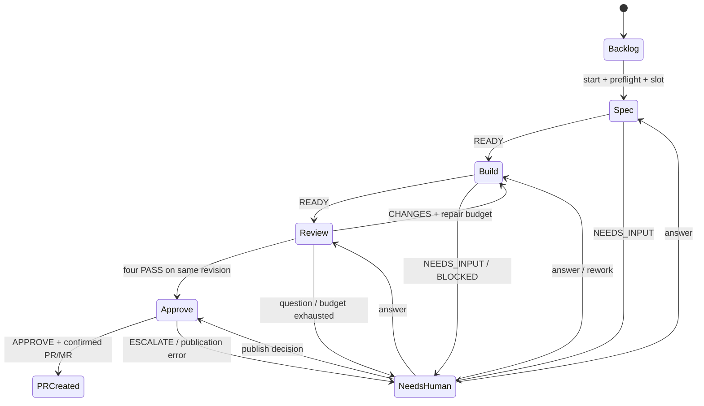

# Технический дизайн: локальная Kanban-доска для coding agents

Дата: 12 октября 2026 года. Версия: 1.2.

Статус: технический стек согласован пользователем 12 октября 2026 года и зафиксирован в [ADR-0001](adr/0001-local-mvp-stack.md); остальные детали реализации [PRD](PRD.md) сохраняют статус предложений и указанные ниже границы проверки. Код приложения ещё не создан. Минимальный Codex protocol smoke выполнен 12 октября; его границы указаны в §7. План отделяет первый прототип от последующих доработок надёжности.

## 1. Границы и инварианты

Актуальный scope: macOS; один пользователь; локальный backend и браузерный Kanban; только Codex; четыре reviewer и отдельный approver; три исполняемые задачи; две автоматические доработки. Pipeline заканчивается созданием PR/MR. Любой merge пользователь выполняет на GitHub/GitLab, вне приложения.

Проверки качества — агентские reviews и существующий CI/CD проекта. Backend не запускает независимый обязательный tests/lint/build runner. Его schema/state/Git проверки обеспечивают работу приложения, но не доказывают качество кода задачи. Прерывание, session resume и crash recovery дорабатываются после первого прототипа.

Рабочие роли Codex запускаются с полными разрешениями по решению пользователя. Инструкции и worktree не являются sandbox: агент технически может обращаться к другим файлам, credentials и hosting API. По workflow contract он работает только в задаче и не выполняет merge. Title generation до запуска не должна менять проект.

Инварианты первого прототипа:

1. Backend управляет переходами; агент возвращает структурированный результат.
2. Build не пересекается с Review одной задачи; не более трёх исполняемых задач.
3. Результат связан с task/run, редакцией требований и версией кода; старый PASS не подходит изменённому коду.
4. Вопрос принадлежит конкретной задаче и попытке; один ответ не запускает её дважды.
5. `pr-created` означает подтверждённый PR/MR с URL, а не успешный CI или merge.
6. Основной checkout не редактируется; автоматические stash/reset/force push отсутствуют.
7. Сохранённые карточки и отчёты переживают restart, но исполнение автоматически не возобновляется.

## 2. Компоненты и технологический выбор

Один Node.js LTS + TypeScript backend с Fastify обслуживает React UI, собранный Vite. SQLite хранит состояние, файлы — большие отчёты и логи. HTTP JSON используется для действий, SSE — для событий. Точные версии зависимостей фиксируются при реализации в lockfile.

| Компонент | Ответственность |
| --- | --- |
| React UI | Доска, карточки, вопросы, отчёты; без локальной бизнес-истины |
| Fastify API | Schema validation, предметные действия, HTTP/SSE |
| Controller и scheduler | Переходы, repair budget, очередь и три task slots |
| Process runner | Executable, argv, cwd, stdin/stdout, завершение CLI |
| Codex adapter | Prompt, JSONL progress, структурированный result |
| Git coordinator | Preflight, worktrees, commits и SHA |
| GitHub/GitLab adapters | Push/create PR/MR и получение identity/URL |
| SQLite и файлы | Карточки, попытки, решения, отчёты и логи |

SQLite используется через согласованный `better-sqlite3`, без ORM; native dependency проверяется на текущем Mac при сборке. Не нужны Redis, PostgreSQL, Kafka, Temporal, Electron и отдельные сервисы. Один Codex adapter не требует multi-provider SDK или plugin abstraction заранее.

Backend — отдельный локальный процесс, обслуживающий frontend. Закрытие вкладки не останавливает backend. Автозапуск при входе в macOS не входит в MVP; после явного запуска пользователь получает URL.

## 3. Хранение и владение данными

Предлагаемый data directory: `~/Library/Application Support/AgentKanban/`; название рабочее. Репозитории пользователя не содержат runtime state приложения.

```text
<data-dir>/
  state.sqlite
  artifacts/<task-id>/<run-id>/
    input.json
    result.json
    report.md
    events.jsonl
    stderr.log
  worktrees/<project-id>/<task-id>/
```

SQLite — источник истины для карточки и принятых решений. Файл отчёта сам по себе не запускает переход. Предыдущие отчёты не перезаписываются. Process handles и очередь активного backend могут находиться в памяти; их потеря не должна удалять сохранённую задачу.

| Сущность | Данные |
| --- | --- |
| `projects` | canonical checkout/git-common-dir, remote/host/repository, target, role models, agent setup instructions, config revision |
| `tasks` | описание/revision, title, stage/run state, wait reason, branch/worktree, base/head, repair count, state version, PR/MR identity/URL |
| `task_revisions` | исходное описание и уточнения; immutable revisions |
| `runs` | task/role/round/attempt, config snapshot, CLI/model, session ID при наличии, input revisions/SHA, timestamps, status/error |
| `results` | outcome, artifact references, reviewed base/head, agent evidence |
| `human_requests` | task/run, kind, вопрос/варианты, bound revision, status, ответ |
| `events` | monotonic ID, task/run, type, timestamp, payload |
| `settings` | schema version, defaults, executable path |

Один backend владеет data directory; второй scheduler не допускается. Репозитории с одним Git common-dir распознаются как дубликат, а не независимые рабочие пространства.

SQLite использует foreign keys, WAL и короткие транзакции. Переход и событие сохраняются вместе; ответ «сохранено» даётся после commit. Артефакт публикуется после полной записи временного файла; неполный результат не принимается. Миграции не удаляют старую базу. Согласованный backup/restore, orphan artifacts и crash/disk-full испытания — следующий этап.

Data directory доступен только текущему пользователю. Tokens не копируются из штатных хранилищ CLI. История автоматически не удаляется, большие логи читаются порциями. Ошибка сохранения блокирует продолжение и показывается пользователю.

## 4. State machine

- `stage`: `backlog | spec | build | review | approve | pr-created | needs-human`.
- `run_state`: `idle | queued | running | waiting | interrupted | completed`. В прототипе interrupted обозначает незавершённую работу после restart, без обещания resume.
- `wait_reason`: `question | human_review | rate_limit | environment | publication`.
- `resume_stage`: этап продолжения после штатного вопроса, не механизм аварийного восстановления.



Controller проверяет run ID, редакцию и допустимый переход с optimistic `state_version`. Невалидный результат — ошибка протокола, а не CHANGES. Agent text не интерпретируется как административная команда.

Две автоматические доработки учитываются `repair_count = 0..2`. Явная доработка после эскалации разрешает новый цикл; история сохраняется. Изменение требований или кода делает зависимые результаты неактуальными. Это обычные правила реализации, а не отдельное исследование до прототипа.

## 5. Scheduler, ресурсы и ожидания

Один backend, FIFO и максимум три активные задачи. После restart очередь не стартует автоматически. Для упрощения прототипа четыре reviewer запускаются последовательно; параллельный запуск внутри задачи — последующая оптимизация. Все четыре роли остаются обязательными, builder ждёт конца раунда.

При NEEDS_INPUT reviewer завершает run; следующая роль ждёт ответа. Ответ сохраняется и ставит продолжение в очередь. Слот освобождается после завершения run; одного изменения статуса в памяти недостаточно, если процесс ещё работает. Сложные случаи остановки потомков проверяются после прототипа.

Title generation использует тот же лимит задач и не пересекается с другой ролью своей задачи. Если заголовок не готов при старте, его можно получить вместе со Spec. Подтверждённый rate limit приостанавливает новые runs до известного reset time; иначе требуется ручное продолжение. Молчаливой смены модели и покупки credits нет.

## 6. Роли, контекст и контракты результатов

Все роли используют Codex и доступную модель из конфигурации пользователя. Модель можно переопределить для роли. Конфигурация фиксируется при запуске задачи; недоступная модель даёт ошибку без молчаливой подмены. Автоматический каталог моделей не нужен.

Каждый run получает task/run ID, редакцию требований, абсолютный worktree, base/head SHA, инструкции роли, применимые repo instructions и предыдущие результаты. Reviewers и approver работают в отдельных сессиях. Первый прототип передаёт сохранённый контекст в новый run; продолжение старой CLI session не является обязательным.

Backend-owned envelope: `schema_version`, `task_id`, `run_id`, `role`, `round`, `description_revision`, `spec_revision`, `base_sha`, `head_sha`, `outcome`, `summary`, `artifact_refs`. Принадлежность результата и Git state проверяет backend; echo идентификаторов от модели не является доказательством.

| Роль | Результат |
| --- | --- |
| Title | Короткий заголовок из описания; без новых требований и изменения проекта |
| Spec | READY/NEEDS_INPUT; требования, acceptance criteria, допущения, out-of-scope |
| Build | READY/BLOCKED; изменённые пути, отчёт о реализации и действиях агента |
| Review | PASS/CHANGES; findings, evidence, applicability; неприменимость UI/UX объясняется |
| Approve | APPROVE/ESCALATE; соответствие задаче и причины риска; решение о публикации, не о merge |

Любая рабочая роль может вернуть NEEDS_INPUT. Это завершает run и не расходует repair budget. Backend проверяет JSON Schema и результат процесса. PASS — содержательное мнение агента, а не независимое доказательство прохождения тестов. Backend runner для tests/lint/build отсутствует. Агент может запускать команды в ходе работы; детерминированный контроль качества проекта остаётся в его CI/CD.

По workflow contract только Build меняет source. Остальные роли имеют full access, но инструктируются не менять его; изменение source аннулирует reviews прежней версии. Последовательный запуск уменьшает конкуренцию за worktree. Browser tool для необходимой UI/UX-проверки берётся из настроенного окружения проекта; без возможности нужной проверки роль блокируется с вопросом, а не выдаёт фиктивный PASS.

## 7. Codex adapter

Один встроенный модуль. Минимальный контракт: запустить prompt в нужном cwd, читать JSONL progress, получить финальный результат по JSON Schema, различать успех и ошибку. Продуктовый вопрос передаётся результатом NEEDS_INPUT; ответ поступает в новую попытку с сохранённым контекстом.

Для рабочих ролей предполагается `codex exec --json --dangerously-bypass-approvals-and-sandbox --output-schema <schema> -` с explicit cwd и prompt через stdin. Это выбранный пользователем full-access режим. Изменение файла проверяется в одноразовом репозитории при реализации адаптера. Ошибка, неполный stream или невалидный result не переводят задачу дальше. App-server bridge и live tool approvals не нужны.

Штатная authentication остаётся в хранилище CLI. Модель задаётся настройками роли либо берётся из существующей конфигурации. Нативный интерактивный вопрос не получает автоматического ответа; агент инструктируется возвращать NEEDS_INPUT.

### Что уже проверено 12 октября 2026

- Установлен `/opt/homebrew/bin/codex`, версия `0.160.1`; `codex login status` сообщает ChatGPT authentication.
- Локальные help подтверждают `exec --json`, `--output-schema`, `--output-last-message` и `exec resume <SESSION_ID>`.
- Реальный запрос выполнен с `--ephemeral --ignore-user-config --sandbox read-only --skip-git-repo-check`, отключёнными shell/web search и заданной схемой. Получены `thread.started`, `turn.started`, `item.completed`, `turn.completed`, exit code 0 и `{"outcome":"READY","summary":"protocol-ok"}`. Tool events в этом запуске не было.
- Внешняя sandbox среды исследования сначала запретила инициализацию CLI. Smoke прошёл после разрешённого запуска вне внешней sandbox, при сохранении read-only режима самого CLI.

Это подтверждает auth и базовый обмен prompt → JSONL → structured result. Это не проверка full-access изменения файлов, NEEDS_INPUT цикла, resume или технического отключения всех возможных tools. Title mode до старта должен исключать изменение проекта; полный набор ограничений проверяется в S-12. Настройки пользователя не изменялись.

Официальная документация: [Non-interactive mode](https://learn.chatgpt.com/docs/non-interactive-mode), [Configuration Reference](https://learn.chatgpt.com/docs/config-file/config-reference). Поддержка флага в help и удачный smoke не заменяют испытание всей роли.

## 8. Human requests и решения

Запрос имеет `kind=question` либо `decision` по ESCALATE approver. Merge decisions и permission prompts отдельных tools отсутствуют.

1. Агент завершает run с NEEDS_INPUT/ESCALATE.
2. Backend сохраняет вопрос с task/run ID и текущей редакцией.
3. UI показывает текст, варианты и свободный ответ; ничего не выбирает автоматически.
4. Ответ сохраняется один раз. Повторный submit не создаёт второго run; ответ на отозванный вопрос отклоняется.
5. После выделения слота новая попытка получает вопрос и ответ. APPROVE либо разрешение публикации по ESCALATE ведёт к созданию PR/MR.

Reviewer в прототипе последовательны: при вопросе следующая роль не стартует. Ответ без изменения требований сохраняет результаты с теми же входными данными; изменение требований требует пересмотра зависимых результатов. Несколько вопросов одного результата показываются вместе; продолжение — после всех обязательных ответов.

Закрытие вкладки не теряет вопрос. После restart ответ сам не запускает исполнение. Сложные гонки нескольких reviewer и recovery не являются предварительным блокером разработки.

## 9. Git и рабочие пространства

Git coordinator использует explicit cwd/argv. Один worktree на задачу разделяет ветки, но linked worktrees имеют общие Git metadata; это не sandbox.

1. Определить canonical repository path, Git root, remote identity; проверить отсутствие merge/rebase в подключённом checkout.
2. Проверить staged, unstaged и неигнорируемые untracked изменения. Dirty checkout блокирует новый старт; stash/discard автоматически не выполняются.
3. Fetch выбранного remote и фиксация target SHA. Локальная ветка не reset/pull/checkout-ится. Неопубликованные локальные commits показываются отдельно, не подмешиваются в задачу.
4. Создать ветку `factory/<task-id>` и worktree от выбранного SHA. Название не зависит от LLM-заголовка.
5. Передать агенту инструкции project setup; backend не добавляет стадию независимых project checks.

Preflight повторяется перед реальным стартом из очереди. Основной checkout после этого не подмешивается в работу. После сбоя dirty task worktree сохраняется; безопасное resume добавляется после прототипа.

Commit фиксирует coordinator с explicit paths после проверки дерева. Если builder уже создал commits, coordinator проверяет branch/history и не дублирует commit. Нельзя автоматически добавлять секреты, неожиданные untracked files или весь checkout через blanket staging. Перед Review фиксируются base/head и чистота source tree; report artifacts находятся вне tracked source. Изменение source делает прежние reviews stale.

Автоматической синхронизации с каждым изменением target нет. Приложение публикует PR/MR; актуальная интеграция с target, конфликты и merge остаются пользователю и платформе. Worktree и branch автоматически не удаляются. Cleanup с проверкой данных и процессов — позднее; локального pull после внешнего merge нет.

## 10. Создание PR/MR

Hosting adapters используют авторизованные `gh`/`glab`, JSON output и explicit repository/host. Тексты передаются через файлы/structured input, без shell interpolation. Backend не вызывает merge, не включает remote auto-merge и не управляет queues/trains.

После четырёх PASS и APPROVE либо решения человека по ESCALATE backend проверяет актуальность source, ищет существующий PR/MR по source branch, target и task marker, затем выполняет push/create. Описание содержит задачу, summary и отчёты. Identity/URL сохраняются; только после этого задача становится `pr-created/completed`.

При timeout исход публикации может быть неизвестен. Прототип останавливается с явной причиной и предлагает ручную сверку remote; слепой повтор push/create запрещён. Полный журнал операций, reconciliation и crash injection добавляются после прототипа. Обычный повторный click защищается состоянием задачи и сохранённой identity.

CI/CD запускается платформой согласно её настройкам. Приложение предоставляет ссылку на PR/MR; собственный CI polling, gates и интерпретация required checks не нужны. Отсутствующий или failed CI не мешает созданию PR/MR и не считается PASS. Решение о merge и branch protection остаются на платформе.

## 11. Прерывание, отмена и восстановление

Это следующий этап после первого рабочего прототипа. Минимальный backend хранит process handles в памяти, карточки и отчёты в SQLite. Закрытие вкладки не останавливает работу.

После restart незавершённые задачи отображаются как interrupted без автоматического запуска. Прототип не обещает безопасное resume после аварии; пользователь вручную проверяет оставшиеся процессы, worktree и remote. Частичные файлы сохраняются, автоматического reset/discard нет. Неизвестное состояние нельзя показывать как завершение или автоматически повторять в том же worktree.

Последующие доработки:

- Interrupt/Cancel: закрыть запуск следующих ролей, остановить свой CLI и его потомков, дождаться завершения и сохранить состояние.
- Resume: сверить worktree/remote, использовать конкретный session ID либо новый run с сохранённым контекстом.
- Recovery: проверить ownership процессов и незавершённые публикации; не убивать чужой процесс по одному совпавшему PID.
- Fault injection: partial edit/commit, timeout после PR/MR create, crash backend, full disk и backup restore.

Статус в памяти описывает намерение controller, но не останавливает отдельный процесс ОС. Поэтому будущая кнопка Stop должна выполнять фактическую остановку; до её реализации UI не обещает такую возможность.

## 12. UI API, безопасность и наблюдаемость

Предметные endpoints: projects/settings; tasks/create/read/update-before-start; actions `start`, `rework`; human-request answer; report/log reads; health/capability checks. Interrupt/resume/cancel добавляются позже. Endpoint merge и общий «выполни shell» endpoint отсутствуют.

Mutating запросы имеют request ID и expected state version. Backend проверяет принадлежность task/project, schema и allowed transition. SSE передаёт сохранённые события; при reconnect UI получает snapshot и недостающие события. Raw token streaming не обязателен.

- Backend слушает только loopback; UI/API используют один origin, CORS не открывается всем сайтам.
- Session bootstrap token и защита от CSRF/чужого Origin нужны и локальному приложению, управляющему CLI.
- Browser не получает provider tokens или произвольный filesystem access; артефакты читаются по ID с защитой от traversal/symlink escape.
- Markdown/agent text выводятся без исполнения HTML/scripts и не становятся backend instructions.
- Spawn получает argv и explicit cwd; description/title/model output не интерполируются в shell.
- Full-access агент остаётся доверенным исполнителем. Отсутствие у него специального backend tool не запрещает shell-доступ к файлам и credentials; workflow не объявляется security boundary.

В run сохраняются CLI/model/version, session ID при наличии, timestamps, base/head, duration, exit/error classification, agent reports и usage, если CLI его сообщает. Usage не выдаётся за точный остаток подписки. Различаются authentication, rate limit, protocol error, missing artifact и publication unknown. Секреты из конфигурации не журналируются; потенциально чувствительный raw output остаётся локальным. Prometheus/Langfuse для MVP не нужны.

## 13. Последовательность реализации и проверки

1. **Codex adapter.** Дополнить выполненный smoke работой в одноразовом repo: file edit, READY/PASS/NEEDS_INPUT и ошибка. Title mode отдельно. Claude и session resume не требуются для старта.
2. **Одна вертикальная задача.** SQLite/UI/controller: описание → Spec → вопрос/ответ → Build → четыре последовательных Review → Approve → PR/MR. Начать с доступного hosting, затем проверить второй до заявления о поддержке обоих.
3. **Остальной MVP.** Несколько проектов, три task slots, фильтры, ошибки/лимиты, отчёты, keyboard accessibility.
4. **Надёжность после прототипа.** Interrupt/Cancel/Resume, process lifecycle, reconciliation публикаций, fault injection и установка в чистом окружении.

Небольшие тесты самого приложения проверяют переходы, принадлежность вопросов, лимит задач, stale results, repair budget и ошибки CLI. Это не backend test runner для пользовательских проектов. Полная модель гонок, merge исследования и crash suite не предшествуют первому прототипу.

## 14. Непроверенные предположения и минимальные проверки

ID сохранены для связи с ранними заметками; прежняя обязательность пересмотрена. Короткий smoke из §7 не означает завершение всей S-01/S-12.

| ID | Проверка | Когда и критерий |
| --- | --- | --- |
| S-01 | Codex prompt → JSONL → structured result; file edit и NEEDS_INPUT | Базовый smoke выполнен; остальные сценарии при создании адаптера |
| S-02 | Claude CLI | Исключено из текущего scope |
| S-03 | Вопрос → ответ → новая попытка правильной роли; duplicate submit | В первом прототипе, без отдельного исследования |
| S-04 | Interrupt/Cancel и остановка дерева процессов | После прототипа; статус stopped соответствует фактической остановке |
| S-05 | Resume/fallback после partial edit и commit | После прототипа; сохранённые правки не теряются |
| S-06 | Правильный cwd, сохранность checkout, reviews актуального source | В вертикальном сценарии; full access не объявляется sandbox |
| S-07 | Строгий merge по source/base, CI gates, queues | Исключено: приложение не выполняет merge |
| S-08 | Восстановление после неизвестного push/create | После прототипа; до этого unknown блокирует слепой retry, требуется ручная сверка |
| S-09 | Не более трёх активных задач, ответ ждёт слота | При добавлении scheduler; reviewer сначала последовательны |
| S-10 | Crash/disk-full, orphan artifacts, backup restore | После прототипа; обычное сохранение карточек реализуется сразу |
| S-11 | Установка на целевом Mac | Прототип на текущем Mac; расширенная support matrix после него |
| S-12 | Выбранная модель и title mode без изменения проекта | Auth и один structured call подтверждены; полный title contract ещё проверить |

## 15. Связь с критериями PRD

| Область | Acceptance criteria |
| --- | --- |
| UI/project/title/model | AC-01–AC-04, AC-07, AC-22–AC-23 |
| Worktree и role contracts | AC-05–AC-09, AC-17 |
| Вопросы, Codex, scheduler | AC-10–AC-12, AC-16 |
| PR/MR без merge и CI gates | AC-13–AC-15, AC-18 |
| Сохранение без auto-restart | AC-19 |
| После прототипа: interruption/cancel/resume | AC-20–AC-21 |

Изменения scope от 12 октября: только Codex, без merge из приложения, без независимого backend runner для проектных checks, recovery после первого прототипа. Четыре review-роли и approver сохранены; Claude adapter и multi-provider SDK заранее не строятся.
