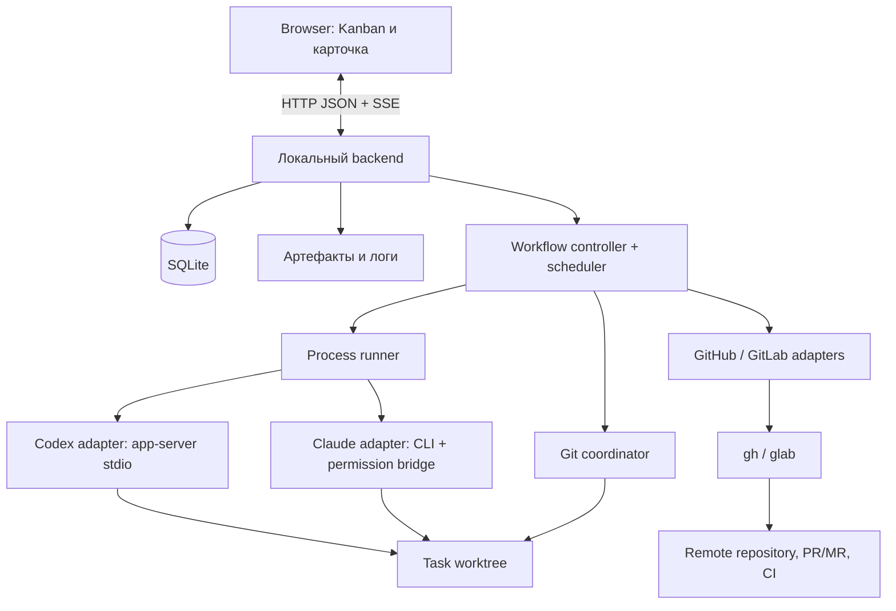
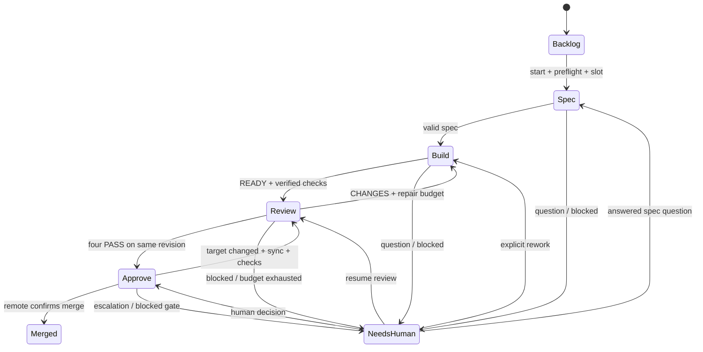
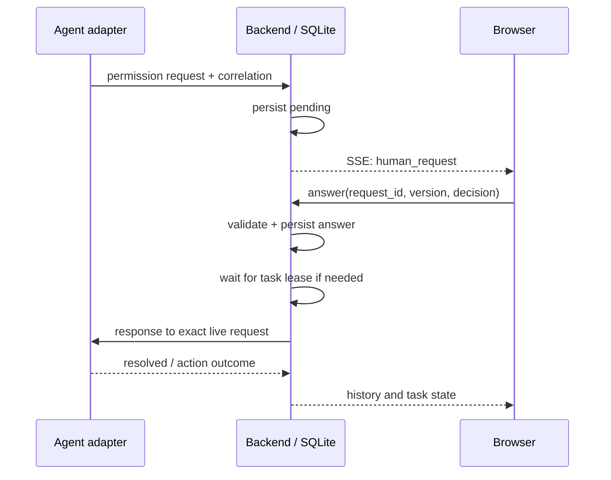

# Технический дизайн: локальная Kanban-доска для coding agents

Дата: 11 октября 2026 года. Версия: 1.0.

Статус: предлагаемая реализация согласованного [PRD](PRD.md). Это дизайн, не описание существующего приложения. Код и интеграционные прототипы не создавались. Указанные ниже runtime-проверки обязательны до заявления о работоспособности.

## 1. Границы и инварианты

Продуктовые решения взяты из интервью и не пересматриваются: только macOS; личный локальный backend; браузерный Kanban; описание без ручного заголовка; Claude Code и Codex; фиксированные стадии; четыре reviewer; отдельный approver; три исполняемые задачи; две автоматические доработки; строгий merge; решения человека в карточке; ручное продолжение после перезапуска.

Предлагаемые технические решения: один TypeScript backend, SQLite, файлы артефактов, HTTP+SSE для браузера, Codex app-server по stdio и Claude CLI с локальным MCP permission bridge. Конкретные package/CLI versions фиксируются после прототипов, а не объявляются проверенными в этом документе.

Инварианты:

1. Единственный writer состояния pipeline — backend. Агент возвращает результат, но не меняет стадию и не пишет базу приложения.
2. Для одной задачи одновременно активна одна стадия; Build не пересекается с Review. Четыре reviewer внутри Review допустимы.
3. Не более трёх задач имеют право исполнять работу. Число дочерних процессов может быть больше.
4. Результат связан с `task_id`, редакцией требований, `run_id`, round, base SHA и head SHA. Старый READY/PASS не подходит новой попытке.
5. Разрешение человека связано с неизменяемым запросом. После изменения версии кода, аргументов действия или поколения процесса требуется новое решение.
6. `merged` устанавливается по подтверждённому состоянию remote. Разрешение merge, постановка в очередь и exit code не являются фактом merge.
7. Основной checkout пользователя не редактируется. Автоматические stash/reset/force push отсутствуют.
8. Перезапуск backend восстанавливает информацию, но не разрешает возобновление исполнения.

## 2. Компоненты и технологический выбор



| Компонент                         | Ответственность                                                                            |
| --------------------------------- | ------------------------------------------------------------------------------------------ |
| React UI, Vite build              | Доска, формы, лента событий, отчёты, ответы на вопросы; без локальной бизнес-истины        |
| Node.js LTS + TypeScript, Fastify | Локальный HTTP API, проверка входных данных, SSE, жизненный цикл backend                   |
| Workflow controller               | Допустимые переходы, проверки артефактов, repair budget, merge gates                       |
| Scheduler                         | Три task leases, очередь и возобновление после ожидания                                    |
| Process runner                    | Executable/cwd/env, stdin/stdout, process group, выход/остановка, принадлежность процессов |
| Два agent adapters                | Provider-specific запуск, события, результаты, permissions и session resume                |
| Git coordinator                   | Preflight, worktrees, commits, SHA, синхронизация целевой ветки                            |
| Два hosting adapters              | PR/MR, CI и правила ветки, source-head guard, merge и reconciliation                       |
| SQLite + файлы                    | Долговечное состояние, журнал решений, результаты и большие логи                           |

Выбор TypeScript уменьшает число языков и позволяет использовать единые типы HTTP/event envelopes. Fastify нужен для маршрутизации и schema validation; схемы создаёт приложение, а не пользователь или модель. [Fastify validation](https://fastify.dev/docs/latest/Reference/Validation-and-Serialization/).

SQLite предлагается использовать через `better-sqlite3`, без ORM: здесь короткие транзакции и один backend writer. Native dependency требует проверки установки на целевых Mac. Причина не брать пока `node:sqlite` — его API всё ещё помечен как предварительный в просмотренной документации. [better-sqlite3](https://github.com/WiseLibs/better-sqlite3), [node:sqlite](https://nodejs.org/api/sqlite.html).

Не нужны Redis, PostgreSQL, Kafka, Temporal, Electron и отдельный микросервис для каждого адаптера. Зависимости и их точные версии выбираются один раз при реализации и сохраняются в lockfile.

Backend запускается отдельным локальным процессом и обслуживает собранный frontend. Закрытие браузера не является сигналом остановки. Автозапуск при входе в macOS не входит в MVP; после явного старта приложения пользователь получает URL локального UI.

## 3. Хранение и владение данными

Предлагаемый data directory: `~/Library/Application Support/AgentKanban/`; имя рабочее и не фиксирует название продукта. Репозитории пользователя не содержат доску или runtime state.

```text
<data-dir>/
  state.sqlite
  artifacts/<task-id>/<run-id>/
    input.json
    result.json
    report.md
    events.jsonl
    stderr.log
  worktrees/<project-id>/<task-id>/
  runtime/
    backend.lock
    permission.sock
    processes/<run-id>.json
```

SQLite — источник истины для стадии и принятых решений. Файлы — содержимое артефактов и большие логи; файл `build.md` сам по себе не запускает переход. Отчёты предыдущих попыток не перезаписываются.

### Логическая схема

| Сущность           | Основные данные                                                                                                                                                                      |
| ------------------ | ------------------------------------------------------------------------------------------------------------------------------------------------------------------------------------ |
| `projects`         | canonical checkout/git-common-dir, remote host/repository, target branch, hosting provider, role settings, checks/setup, merge policy, config revision                               |
| `tasks`            | project, generated title/title state, description revision, stage, run state, wait reason, resume stage, branch/worktree, current base/head, repair count, sync count, state version |
| `task_revisions`   | дословное описание, уточнения и источник изменения; immutable revisions                                                                                                              |
| `runs`             | task/role/round/attempt, config snapshot, protocol/CLI version, provider IDs, process ownership, input SHA/revisions, timestamps, status, error                                      |
| `results`          | run, artifact references+hashes, normalized outcome, checked base/head, validation evidence                                                                                          |
| `human_requests`   | task/run/attempt, kind, original payload+hash, provider correlation, options, status, answer, expiry/revocation, bound code/config revision                                          |
| `events`           | monotonic ID, task/run, event type, timestamp, structured payload; durable UI history                                                                                                |
| `operations`       | operation ID, task, kind, expected state/head/base, request fingerprint, status, remote identity/result; external side-effect journal                                                |
| `execution_leases` | task owner, backend generation, acquired time; максимум три                                                                                                                          |
| `settings`         | schema version, global defaults, detected executables и локальные предпочтения                                                                                                       |

`runs` отделяет попытку процесса от задачи и логического раунда. Четыре review results образуют один раунд. Новое исполнение после сбоя — новая попытка, но не автоматически новый repair round.

Один процесс backend владеет data directory. Singleton lock проверяет не только PID, но и идентичность экземпляра. Второй запуск открывает существующий UI или сообщает занятость; не создаёт второго scheduler. Репозитории с одним Git common-dir не регистрируются как независимые рабочие пространства без явного обнаружения дубликата.

Использовать SQLite foreign keys, WAL, короткие транзакции и durable synchronous mode. Изменение состояния и соответствующее событие записываются одной транзакцией. WAL не превращает файловые изменения или remote API в транзакции. [SQLite WAL](https://sqlite.org/wal.html).

Артефакт сначала пишется во временный файл и атомарно публикуется, затем регистрируется в SQLite с hash. После сбоя orphan-файл можно связать с попыткой либо пометить неполным; нельзя автоматически принять его как успешный результат. Ответ браузеру «сохранено» даётся после commit состояния. Миграции схемы не удаляют старую базу; перед миграцией нужен согласованный SQLite backup, не копирование одного live `.sqlite` без WAL.

Права data directory — только текущему пользователю. OAuth/API/hosting tokens не копируются в базу. На MVP нет автоматического удаления истории; большие логи выдаются порциями, а заполнение диска блокирует новые работы с понятной причиной.

## 4. State machine

Храним отдельно `stage` и `run_state`. Это сохраняет исходные колонки и позволяет честно показать ожидание без добавления стадий pipeline.

- `stage`: `backlog | spec | build | review | approve | merged | needs-human`.
- `run_state`: `idle | queued | running | waiting | interrupting | interrupted | cancelled | completed`.
- `wait_reason`: при необходимости `question | permission | human_review | ci | rate_limit | environment | merge_gate`.
- `resume_stage`: этап, куда нужно вернуться из `needs-human`.



Диаграмма показывает содержательные переходы. Permission wait, interruption и cancellation допустимы из любой выполняемой стадии; возврат всегда через сохранённый checkpoint и scheduler, а не по произвольному изменению колонки в UI.

| Событие            | Проверка                                             | Изменение                                              |
| ------------------ | ---------------------------------------------------- | ------------------------------------------------------ |
| Start              | backlog, актуальная редакция, preflight              | queued → spec/running после lease                      |
| Spec READY         | schema, acceptance criteria, нет нерешённых вопросов | build                                                  |
| Build READY        | branch/head/checks/артефакты соответствуют attempt   | новый review round                                     |
| Review result      | роль, round, input revisions, base/head совпадают    | сохранить один verdict; ждать остальные                |
| Все reviews готовы | четыре PASS либо CHANGES                             | approve либо repair/needs-human                        |
| Human answer       | pending request, current version, валидная форма     | записать ответ; queued для продолжения                 |
| Agent APPROVE      | актуальное доказательство, машинные gates            | запросить контролируемую merge operation               |
| Remote merged      | совпадает PR/MR identity                             | merged/completed, сохранить merge commit               |
| Interrupt/Cancel   | действие актуально; повтор идемпотентен              | остановка, reconciliation, затем interrupted/cancelled |

Контроллер проверяет переходы транзакционно с optimistic `state_version`. Агентские сообщения не интерпретируются как административные команды. Невалидный результат не равен CHANGES: это protocol/environment error.

Две автоматические доработки учитываются `repair_count = 0..2`. Явное «Отправить на доработку» после эскалации создаёт новый human-authorized цикл с новым бюджетом; старые счётчики и история остаются. Если человек меняет требования, увеличивается description/spec revision и пересматриваются зависящие от неё результаты.

## 5. Scheduler, ресурсы и ожидания

Очередь хранится в SQLite. В MVP FIFO по времени готовности; приоритеты и сложное планирование не нужны. Выдача lease и старт run разделены операционным checkpoint, чтобы crash между ними можно было обнаружить.

Максимум три task leases. Lease удерживается, пока агент, setup/test process или mutating pipeline operation реально исполняют работу. Idle app-server и процесс, подтверждённо ожидающий разрешения, сами по себе не занимают вычислительный слот задачи.

При нескольких reviewer задача освобождает lease только после quiescence: все reviewer завершены или ожидают ответа и ни один tool/test не продолжает исполняться. Новые reviewer после появления блокировки не запускаются. UI может уже показывать Needs human, но внутренний lease ещё удерживается до безопасной точки.

Ответ человека сохраняется сразу. Если свободного lease нет, UI показывает очередь; адаптер не отправляет разрешение или новый prompt, способный возобновить выполнение, до выдачи lease. Отказ тоже может заставить агента продолжить reasoning, поэтому отправляется по тому же правилу. Если provider timeout истёк раньше, запрос становится устаревшим, требуется reconciliation и новый запрос.

CI и remote polling не используют task lease. Получение конечного результата само по себе не запускает следующего агента без scheduler. При подтверждённом rate limit блокируется запуск новых runs этого provider до доступного reset time; если reset неизвестен, пользователь продолжает вручную. Покупка credits и смена провайдера не происходят автоматически.

Генерация заголовка — короткая metadata work item, привязанная к задаче. Она использует общий лимит, не запускается одновременно с агентом этой задачи и не переводит Backlog в Spec. Если заголовок ещё не готов при старте, его можно получить вместе со Spec, не дублируя вызов.

Предлагаемые технические пределы, не новые продуктовые опции: один автоматический повтор только для однозначно безопасного сбоя до начала действий; максимум две последовательные синхронизации с меняющейся target branch за цикл, затем человек. Потеря соединения после side effect не считается безопасным сбоем для слепого retry.

## 6. Роли, контекст и контракты результатов

### Настройки по умолчанию

| Роль                  | Предлагаемый default                                                |
| --------------------- | ------------------------------------------------------------------- |
| Заголовок             | CLI/модель Spec, короткий запрос без tool access                    |
| Spec                  | Claude Code, `opus`                                                 |
| Build                 | Codex, модель из действующей конфигурации CLI, разрешённая аккаунту |
| Review security       | Claude Code, `opus`                                                 |
| Review code / UI / UX | Claude Code, `sonnet`                                               |
| Approve               | Claude Code, `opus`                                                 |

Это редактируемые defaults, а не утверждение о доступности моделей на любом тарифе. На preflight разрешаем aliases в конкретные модели, если provider это поддерживает, и сохраняем запрошенный и фактический ID. Недоступная модель блокирует запуск с выбором пользователя; молчаливой подмены нет. Для Codex список можно получать через `model/list`; для Claude сначала проверяется поддержанный pinned CLI способ, иначе пользователь вводит допустимый model ID. Источник возможностей Codex: [app-server](https://learn.chatgpt.com/docs/app-server).

Каждый запуск получает task ID, description/spec revision, абсолютный worktree, base/head SHA, инструкции роли, применимые repo instructions, свои report/artifact paths и относящиеся к нему предыдущие результаты. Полные transcript других агентов не передаются по умолчанию. История builder может продолжаться после review; reviewers и approver работают с явно зафиксированным контекстом проверки.

Backend-owned result envelope содержит `schema_version`, `task_id`, `run_id`, `role`, `round`, `description_revision`, `spec_revision`, `base_sha`, `head_sha`, `outcome`, `summary`, `artifact_refs`. Поля идентичности и SHA подтверждает backend; echo от LLM не считается доказательством.

| Результат роли | Обязательное содержимое                                                                                 |
| -------------- | ------------------------------------------------------------------------------------------------------- |
| Title          | Короткий plain-text заголовок, без новых требований и tool calls                                        |
| Spec           | Контекст, требования, acceptance criteria, out-of-scope, допущения; READY либо NEEDS_INPUT              |
| Build          | READY/BLOCKED, изменённые пути, команды и результаты проверок, ответы на замечания                      |
| Review         | PASS/CHANGES, findings с объяснением, evidence, applicability; `not_applicable` объясняется внутри PASS |
| Approve        | APPROVE/ESCALATE, выполненные критерии, risk flags и конкретная причина эскалации                       |

Markdown-отчёт — человекочитаемое представление результата. Структурированный результат проходит schema validation, но успешный JSON не доказывает успешность тестов. Backend фиксирует exit codes, полный проверенный command record, head и состояние дерева.

Только Build изменяет исходники. Spec/review/approve получают ограниченные права; разрешённые проверки могут писать build outputs/cache в отведённые места. Изменение tracked source во время Review аннулирует раунд. Несовместимые команды тестов/build сериализуются в одном worktree, даже если четыре LLM reviewer работают параллельно. UI/UX получают разные порты/профили браузера; collision проверяется, номер не выводится только из task ID.

Browser tool для визуальных проверок берётся из заранее настроенного окружения проекта, например исходного `agent-browser`. Если проверка необходима, а инструмента или dev setup нет, это BLOCKED с вопросом, не фиктивный PASS. Автоматическая установка пакетов на машину без разрешения не подразумевается.

## 7. Agent adapters

Это два встроенных модуля, не публичный plugin SDK. Общие операции: проверка доступности/версии, start/resume, поток нормализованных событий, ответ на запрос, interrupt, получение финального результата. Provider payload хранится отдельно; общий интерфейс не притворяется, что все CLI имеют одинаковые возможности.

Нормализованные события: `run_started`, `progress`, `human_request`, `permission_request`, `artifact_ready`, `run_completed`, `run_failed`, `rate_limited`. У каждого есть task/run/attempt и provider correlation, когда она предоставляется.

### 7.1 Codex

Используется установленный `codex app-server` по локальному stdio JSON-RPC. Документированы `thread/start`, `thread/resume`, `turn/start`, `turn/interrupt`, поток событий и server-initiated approvals. App-server помечен experimental и не поддерживаемым для production workloads; это принятая зависимость локального MVP. [Official OpenAI documentation](https://learn.chatgpt.com/docs/app-server).

Предлагаем отдельный app-server process на активный role run: простой ownership и ограниченный blast radius. Четыре reviewer могут породить четыре процесса. Оптимизация через общий server откладывается до измерений.

Adapter выполняет initialize, создаёт либо возобновляет thread, задаёт cwd и разрешения, затем запускает turn. Сохраняются реальные thread/session/turn IDs, а не идентификатор «последней сессии». На protocol parse failure, EOF и failed turn результат не принимается как успешный. Завершённый turn сам по себе не означает READY или PASS — нужен result contract.

Для команд и файлов поддерживаются requestApproval с явным ответом по request ID. В UI MVP используем разовое разрешение, отказ и прерывание; session-wide grants и изменение постоянных правил не выдаются скрыто. Отдельные permission/network запросы отображаются с их фактической областью доступа. Устаревшие server requests инвалидируются. Подробности wire format берутся из pinned schema, не из произвольного разбора текстовых сообщений.

Приложение использует штатную Codex authentication. Веб-клиент не получает токены. Нельзя заменять этот адаптер на `exec --json`, сохраняя обещание двусторонних approvals; нельзя возвращать удалённый `codex mcp-server`.

### 7.2 Claude Code

Запускается штатный `claude -p` с потоковым JSON output и сохранением сессии. `--permission-prompt-tool` связывает запросы с локальным MCP permission host; `--resume` адресует конкретную историю. Не используем `--bare` или отключение persistence как безусловную оптимизацию подписочного сценария. [CLI reference](https://code.claude.com/docs/en/cli-reference), [headless](https://code.claude.com/docs/en/headless).

Предлагаемый bridge — маленький stdio MCP process, запускаемый Claude из конфигурации конкретного run. Он передаёт запрос backend через защищённый local socket, ждёт решения и возвращает provider-specific result. Bridge не принимает произвольных shell-команд и не имеет собственной бизнес-логики merge. Он нужен для protocol adaptation, а не для отдельного backend service.

**Точный MCP input/result envelope, correlation и сроки ожидания ещё не подтверждены практикой.** Нельзя выдавать SDK `canUseTool` schema за установленный wire contract `permission-prompt-tool`. Это обязательный spike S-02. Не используем недокументированный stdin control protocol только потому, что есть флаг stream-json.

Существующие permission hooks могут конкурировать с host, а отдельные интерактивные MCP и network requests имеют ограничения. Они не должны приводить к показу кнопки, которая фактически уже ничего не контролирует. Для неподдержанного request — объяснимый Needs human без автоматического allow. [Claude hooks](https://code.claude.com/docs/en/hooks#permissionrequest).

Для освобождения task lease нужен подтверждённый контроль над возобновлением: сторонний hook не должен разрешать ожидающее действие за спиной scheduler. Способ ограничить конкурирующие handlers на уровне конкретного запуска проверяется S-02; глобальные пользовательские настройки не переписываются. Если обеспечить это нельзя, такой набор CLI/settings не считается поддержанным для managed execution.

### 7.3 Вопросы по требованиям

Для продуктовых вопросов базовый переносимый путь — role result `NEEDS_INPUT` с вопросами: run заканчивается в checkpoint, backend показывает форму, после ответа роль продолжается с сохранённым контекстом. Это не требует постоянно держать RPC открытым.

Нативные tool-вопросы, возникающие посреди turn, обрабатываются отдельно: supported Codex user-input event или Claude tool/hook bridge. Их точные схемы входят в adapter spikes. Нельзя подменять вопрос разрешением команды или автоматически выбирать рекомендуемый вариант.

### 7.4 Версии и auth

Preflight сохраняет binary path/version, поддержанные capabilities и модель; проверенный version range адаптера задаётся после spikes. Неизвестная несовместимая версия даёт actionable error, не автообновление CLI.

Credentials остаются в штатных хранилищах CLI. Для личного сценария не строим OAuth gateway и не импортируем tokens в backend. Это не обещание разрешённости будущего hosted/многопользовательского продукта с теми же credentials: такой продукт вне MVP. [Claude authentication restrictions](https://code.claude.com/docs/en/legal-and-compliance#authentication-and-credential-use).

## 8. Human requests и approvals

Все обращения хранятся в общей таблице, но имеют разные `kind`: `question`, `decision`, `permission`. Ответы проверяются по отдельным схемам. `decision` может разрешить риск, препятствующий автоматическому merge, но не превратить failed CI в PASS.

### Жизненный цикл запроса

1. Adapter/controller получает исходный payload и назначает app request UUID.
2. Backend сохраняет request вместе с run/attempt, transport generation, provider request ID и payload hash; публикует событие после commit.
3. UI показывает неизменённый смысл запроса, область действия и допустимые ответы. Рекомендуемый ответ не отправляется автоматически.
4. Ответ проходит проверку версии и одноразового статуса; двойной submit возвращает существующий результат.
5. Для ответа, возобновляющего агентскую работу, scheduler сначала выделяет task lease. До этого `answered_queued`.
6. Backend журналирует delivery и отправляет provider-specific response. Подтверждение провайдера переводит запрос в `resolved`.
7. Если результат доставки неизвестен, запрос остаётся `delivery_unknown`, а не отправляется снова вслепую.

Статусы: `pending`, `answered_queued`, `delivering`, `resolved`, `expired`, `revoked`, `delivery_unknown`. Несколько запросов одного run не перезаписывают друг друга. Истёкшие или отозванные кнопки недоступны; reason виден в истории.



Для команд показываются полный command preview и cwd, для файлов — пути, тип действия и ссылка на доступные подробности изменения, для network — destination/scope. Это не diff viewer. Если разрешение действительно шире одной команды, UI обязан показать реальную область; label «один раз» не должен скрывать grant на весь turn.

Close tab не закрывает MCP/RPC request. При backend restart нельзя восстанавливать старый live request ID из одной только базы и посылать его в новый процесс. Старые requests становятся revoked/unverified, агент должен заново представить действие. Пользовательское намерение остаётся в истории, но не превращается в автоматическое разрешение нового запроса.

## 9. Git и рабочие пространства

Git operations выполняет контролируемый coordinator с explicit cwd/argv. Один worktree на задачу обеспечивает изоляцию веток, но linked worktrees разделяют Git metadata; это не sandbox. [Git worktree](https://git-scm.com/docs/git-worktree).

### Старт

1. Разрешить canonical repository path, проверить Git root, remote identity, отсутствие merge/rebase в подключённом checkout.
2. Проверить `git status --porcelain` с учётом untracked. Любая неигнорируемая незакоммиченная запись блокирует новый старт; ignored caches не блокируют.
3. Выполнить fetch выбранного remote и разрешить target ref в конкретный SHA. Локальная ветка пользователя не reset/pull/checkout-ится. Источник задачи — выбранный remote target; локальные неопубликованные commits показываются как отдельное отличие, не подмешиваются скрыто.
4. Создать ветку `factory/<task-id>` и worktree в data directory от зафиксированного SHA. Название не зависит от изменяемого LLM-заголовка.
5. Выполнить project setup и сохранить результат. При ошибке оставить worktree и объяснить причину.

Preflight повторяется непосредственно перед реальным стартом, а не только при нажатии кнопки. Изменения основного checkout после начала не подмешиваются в задачу; новую задачу они блокируют. Продолжение собственного dirty task worktree сначала проходит reconciliation, а не новый clean-check с потерей работы.

### Build и freeze

Builder реализует и проверяет изменение. Commit фиксирует coordinator после проверки дерева и explicit paths; если builder уже создал commits, coordinator валидирует branch/history и не создаёт искусственный дубль. На commit выделяется exclusive write phase задачи. Нельзя автоматически добавлять секреты, неожиданные untracked файлы или весь checkout через blanket staging.

Перед Review сохраняются base/head и чистота source tree. Review/test artifacts пишутся вне tracked source. Любое вмешательство в исходники после freeze делает результаты stale. Agent permission не даёт права самовольно публиковать/мержить ветку; remote side effects проходят отдельный coordinator.

### Обновление target

Выбран merge target SHA в task branch, а не rebase: опубликованная история не переписывается, force push не нужен. На время операции нет работающих агентов этой задачи. При конфликте сохраняются данные и формируется Needs human; автоматическое разрешение конфликта считается новой реализацией с последующим полным review, а не механической синхронизацией.

После успешной синхронизации записываются новые base/head, прежние reviews/approve/human-merge approvals помечаются stale, повторяются все проверки и четыре reviews. Spec также пересматривается, если изменения base затронули её предпосылки. После этого обновляются PR/MR и CI. Это новый validation round; `repair_count` увеличивается только при содержательной автоматической доработке по замечаниям.

### Cleanup

После Merged/Cancelled не удалять worktree или branch автоматически в MVP. Отдельное пользовательское действие проверяет незакоммиченные данные и отсутствие процессов; принудительное удаление не предлагается как default. Основной checkout остаётся как был; приложение не делает локальный pull после remote merge.

## 10. PR/MR, CI и merge gates

Hosting adapter использует авторизованные `gh`/`glab`, JSON output и explicit repository/host. Различия flags и статусов остаются внутри двух адаптеров. Тексты берутся из файлов/structured input без shell interpolation. Никаких `--admin` или иных bypass-режимов.

### Публикация и идемпотентность

После четырёх PASS backend журналирует publish intent, проверяет существующую remote ветку и PR/MR по source branch, target и уникальному task marker, затем push/create. В описание входят исходная задача, summary, проверки и идентификатор задачи. Обновление повторяет проверку SHA и не создаёт новый PR/MR на каждом раунде.

Любой timeout после push/create/merge означает неизвестный исход. Перед retry требуется lookup remote. `operations` хранит `prepared → dispatched → confirmed | unknown | failed`. Exactly-once внешних действий не обещается; цель — обнаружить состоявшееся действие и не повторить его.

### Evidence для merge

Решение связывается с tuple: description/spec/config revision, base SHA, source head SHA, четыре review result IDs, checks run IDs, provider CI identity и approve result либо human decision ID.

Backend проверяет:

- Evidence актуален, code tree не изменён и все проверки завершены.
- Обязательные checks известны, относятся к актуальному source/merge candidate и прошли. Отсутствие checks, skipped/neutral без однозначной provider policy, pending и API error не трактуются как success.
- Platform approvals, branch protection и запреты merge соблюдены.
- Agent verdict APPROVE или человек явно разрешил данную эскалацию; содержательные CHANGES не игнорируются.
- Auto-merge включён и изменение попадает в разрешённую категорию; иначе нужен человек.
- Нет другого merge этого canonical remote repository.

Документация/тесты определяются сочетанием настроенных project paths, анализа diff и risk flags reviewer/approver. Одного расширения файла недостаточно: Markdown может управлять агентом, а тестовый helper — исполнять privileged code. Если пути/тип не определены, automatic eligibility = false. CI, dependencies, executable config и другие чувствительные изменения автоматически не принимаются.

Agent APPROVE с намерением merge инициирует controlled operation: backend повторно проверяет gates и исполняет соответствующий CLI. Это сохраняет агентское решение, не поручая модели вручную обходить проверки shell-командами. По human decision действует тот же machine gate. При неустранимом gate UI предлагает нужное действие, а не кнопку bypass.

### Сериализация и race с target

Один merge coordinator на canonical remote repository, даже если он подключён через два локальных clone. Локальная очередь не блокирует действия людей и CI на remote.

Перед отправкой merge заново читается target SHA; при отличии операция отменяется и задача возвращается к синхронизации. В merge command передаётся source-head guard. GitHub `--match-head-commit` и GitLab `--sha` защищают source HEAD, но не гарантируют неизменность target между чтением и merge. У GitLab queued auto-merge также нельзя считать состоявшимся merge. [gh merge](https://cli.github.com/manual/gh_pr_merge), [glab merge](https://docs.gitlab.com/cli/mr/merge/).

**Непроверенная граница гарантии:** строгая связка «reviewed base = base в момент merge» не обеспечивается одним локальным mutex. Provider-side branch protection/merge queue/train может проверять актуальную интеграцию, но сама по себе не заменяет требование повторить четыре агентских reviews после изменения base. Не утверждаем, что queue решает это автоматически.

S-07 должен установить поддержанный механизм и его пределы для каждого hosting adapter. До этого автоматический merge на конфигурации с недоказуемыми условиями заблокирован с объяснением человеку. Это ограничение готовности интеграции, не отмена требования PRD. Механизм очереди, который сам позже меняет base и мержит без нашего повторного цикла, не включается скрыто.

После отправки операции polling различает `merge_requested`, `queued`, `merged`, `failed`, `unknown`. Только подтверждённый merged state переводит карточку в Merged. При отмене уже отправленного remote запроса проверяется возможность его отзыва; локальная отмена не обещает отменить уже состоявшийся merge.

## 11. Прерывание, отмена и восстановление

Backend владеет процессами через run ID, instance generation, PID/start identity и process group. Одного PID недостаточно из-за reuse. Остановка направляется только процессам с подтверждённой принадлежностью.

### Плановая остановка

1. Закрыть gate новых tool/merge actions для задачи, сохранить interrupt/cancel intent.
2. Попросить adapter завершить turn/процесс; дождаться ограниченное время.
3. При необходимости остановить подтверждённое дерево процессов; невозможность доказать остановку отображается как проблема, а не «готово».
4. Зафиксировать Git state, артефакты и неизвестные remote operations.
5. Отозвать неисполненные permissions; сохранить историю и выставить interrupted либо cancelled.

Timeout не означает, что команда ничего не сделала. Даже нормальная остановка не откатывает файлы, отправленные запросы и commits. Claude документирует специальное поведение SIGTERM, но parity всех потомков между CLI не предполагается; проверяется S-04. [Claude interruption](https://code.claude.com/docs/en/headless#stop-a-run-with-sigterm).

### Старт backend после сбоя

Recovery начинается с закрытым execution gate. Проверяются integrity/version SQLite, singleton ownership, незавершённые runs и operations. Приложение не восстанавливает исполнение только потому, что в БД стоял `running`.

Если старые принадлежащие приложению процессы ещё живы, их нужно остановить/привести к подтверждённому ожиданию до разрешения новых запусков. Переподключение к неизвестному stdio-процессу не обещается. Если ownership не доказан, его не убивают по совпавшему PID и не запускают конкурирующий worker в том же worktree; показывается Needs human.

Удалённые queued merge operations сверяются отдельно. Если внешняя платформа уже приняла неотзываемое действие, локальный restart не может гарантировать его остановку; UI показывает этот факт, а не предлагает ложное «ещё не началось». MVP не должен намеренно оставлять отложенный автоматический merge, который обойдёт ручное возобновление и повторную проверку target.

Восстановленные задачи получают interrupted/awaiting explicit resume. Старые task leases не переиспользуются. Pending live-RPC approvals помечаются недействительными; продуктовые вопросы с неизменным контекстом могут оставаться отвечаемыми, но ответ после restart не запускает работу без действия «Продолжить».

| Момент сбоя                      | Recovery                                                                                                    |
| -------------------------------- | ----------------------------------------------------------------------------------------------------------- |
| Во время title generation        | Описание уже в базе; placeholder; повтор только после разрешённого возобновления metadata job               |
| После создания worktree          | Проверить existing path/branch; не создавать второй                                                         |
| Во время Build                   | Сохранить dirty files и commits; сверить ветку; продолжить session либо новый run с checkpoint              |
| После отчёта до commit состояния | Проверить run/head/hash и полноту result; не принимать по одному имени файла                                |
| Во время permission delivery     | Считать исход неизвестным; сверить provider; старый ответ не replay-ить в новый процесс                     |
| После PR/MR create с timeout     | Найти существующий объект по source/target/task marker                                                      |
| После merge с timeout            | Запросить фактический remote state; не повторять merge без проверки                                         |
| Во время CI wait                 | Обновить CI snapshot; для следующей активной стадии всё равно нужен explicit resume                         |
| Worktree удалён пользователем    | Не создавать видимость сохранённого кода; объяснить утрату и предложить восстановление из известных commits |

Продолжение истории CLI — удобство, а не единственный checkpoint. Минимально достаточный контекст новой сессии: описание/уточнения, spec, текущий diff, last build, отзывы текущего раунда и подтверждённые checks. Прежние approvals не переносятся автоматически.

## 12. UI API, безопасность и наблюдаемость

### HTTP и события

Предлагаемые endpoints: projects/settings; tasks/create/read/update-before-start; task actions `start`, `interrupt`, `resume`, `cancel`, `rework`; human-request answer; report/log reads; health и capability checks. Это предметные операции, не общий «выполни shell-команду» endpoint.

У каждого mutating запроса есть request ID и expected state version. Сервер проверяет project/task ownership, allowed transition и schema. Endpoint «поставить любой stage» отсутствует. Merge разрешается через конкретный `human_request`, а не свободный URL с branch name.

SSE передаёт сохранённые события с monotonic ID. При reconnect UI запрашивает актуальный snapshot и недостающие события; прогресс stdout может батчиться, но решения и переходы не теряются. Raw token streaming в карточку не обязателен; важны роль, этап, последнее действие, вопрос и итоговый отчёт.

### Локальная граница безопасности

- Backend слушает только loopback. Один origin для UI/API; CORS не открывается для любых сайтов.
- Session bootstrap token и защита mutating requests от CSRF/чужого Origin нужны даже localhost-продукту: backend управляет файлами и CLI.
- Browser не получает provider tokens или произвольный доступ к filesystem. Артефакты читаются по ID, с canonical-path проверкой против traversal/symlink escape.
- Markdown/agent text считаются недоверенными данными и выводятся без исполнения HTML/scripts; агентский текст не становится backend instruction.
- Spawn получает массив argv и explicit cwd; description, title и model output не интерполируются в shell command. Project setup/test commands — отдельная явная доверенная конфигурация пользователя.
- Рабочие агенты не получают административные инструменты backend, database access или автоматический merge bypass. Sandbox capabilities и inherited hooks проверяются; prompt-only запрет не объявляется security boundary.
- Нельзя обещать полную изоляцию недоверенного кода только на основании Git worktree. MVP рассчитан на доверенные пользовательские репозитории; контроль доступа агента и сохранность основного checkout всё равно проверяются.

### Диагностика

В run сохраняются timestamps, CLI/model/version, session IDs, base/head, duration, exit/error classification, checks и provider usage при наличии. Usage показывается как измерение вызова, не как точный процент остатка подписки, если provider не выдал такой показатель.

Нужны различимые причины: authentication, rate limit, permission denied, protocol error, missing artifact, failed check, interrupted, remote state unknown. Логи не должны включать auth headers/секреты из конфигурации; потенциально чувствительный raw output остаётся локальным, доступным пользователю. Встроенный Prometheus/Langfuse не требуется.

## 13. Последовательность реализации и проверки

На текущем этапе выполняется только документирование. Предлагаемый порядок дальнейшей реализации:

1. **Protocol spikes S-01/S-02/S-04/S-07.** Подтвердить ключевые возможности до полноценного UI. Результат — минимальные проверяемые harnesses и protocol fixtures, не продуктовая фабрика.
2. **Persistence + state machine.** Задачи, поколения attempts, очередь, human requests, crash recovery; CLI заменяются тестовым adapter.
3. **Вертикальный сценарий.** Одна задача от описания и LLM-title до Spec/Build, вопроса в UI, остановки и ручного resume.
4. **Review и hosting.** Четыре reviewers, budgets, Git SHA binding, PR/MR и CI gates, human decision.
5. **Параллелизм и remote races.** Три задачи, ответы после освобождения слота, target update, последовательно выполняемые merges.
6. **Приёмка на macOS.** Реальные Claude/Codex и GitHub/GitLab в тестовых репозиториях; затем проверка всех AC из PRD.

Минимальные meaningful automated checks будущей реализации: таблица допустимых переходов; невозможность четвёртого lease; late/duplicate approval; stale review SHA; timeout после remote side effect; recovery без auto-resume; dirty checkout; invalid result; третий repair запрещён; base movement инвалидирует approvals. Это не тесты UI ради повторения разметки.

End-to-end smoke должен включать отказ разрешения, закрытие вкладки, SIGTERM backend, сохранение частичных правок и восстановление после неоднозначного PR/MR create. Отдельно тестируется изменение target другим участником прямо во время merge gate.

## 14. Непроверенные предположения и минимальные проверки

Ни одна строка ниже не выполнена в рамках подготовки документов. Их результаты определяют готовность интеграции; согласованные возможности не считаются реализованными заранее.

| ID   | Предположение / риск                                                           | Минимальная проверка                                                                                                                                     | Критерий успеха и действие при провале                                                                                                          |
| ---- | ------------------------------------------------------------------------------ | -------------------------------------------------------------------------------------------------------------------------------------------------------- | ----------------------------------------------------------------------------------------------------------------------------------------------- |
| S-01 | Pinned Codex app-server обеспечивает нужный approval roundtrip со штатной auth | Запустить тестовую задачу, получить command и file approval, ответить allow/deny, прервать turn, возобновить thread                                      | Все ответы адресованы правильному запросу; auth остаётся штатной. Иначе блокер Codex adapter, не переход к TUI scraping                         |
| S-02 | Claude permission tool имеет достаточный MCP contract                          | Минимальный MCP host записывает request envelope, возвращает реальные allow/deny; проверить два параллельных запроса, долгий ответ, cancellation и hooks | Зафиксированы schema/correlation/timeouts на конкретной версии. SDK schema не подставляется без подтверждения; несовместимость — блокер функции |
| S-03 | Продуктовые и нативные вопросы можно корректно вернуть из UI                   | READY/NEEDS_INPUT checkpoint и native question: варианты, free text, повторный ответ, stale reply                                                        | Исходные вопросы/ответы сохранены; продолжение верной задачи, без auto-select                                                                   |
| S-04 | Можно остановить принадлежащее задаче дерево процессов на macOS                | Агент запускает длительный test и dev server; interrupt/cancel, закрытие вкладки, crash backend и restart                                                | После остановки нет неучтённых продолжающих писать процессов; данные сохранены; PID reuse не приводит к чужому kill                             |
| S-05 | Resume и fallback не дублируют изменения                                       | Kill после partial edit и после commit; resume живой истории, затем с недоступной session                                                                | Нет отката/повторного применения, checkpoint связан с фактическим Git state                                                                     |
| S-06 | Worktree/sandbox/permissions обеспечивают нужную область доступа               | Попытка изменить task source, основной checkout и application state; test cache writes; dirty source during review                                       | Разрешённая работа выполняется; запрет реально enforce-ится либо capability считается неподдержанной, не маскируется prompt                     |
| S-07 | GitHub/GitLab позволяют выдержать source/base gates                            | На каждом тестовом remote: source change, target change между read и merge, CI pending/fail, protected branch, queue и timeout после merge               | Установлен механизм строгой проверки и его ограничения. Пока base race не закрыт доказуемо, auto-merge для такой конфигурации не включается     |
| S-08 | Повтор create/push/merge идемпотентен на уровне приложения                     | Потерять ответ после успешного remote действия, перезапустить backend и нажать Continue                                                                  | Находится исходный PR/MR/merge; дубль не создаётся                                                                                              |
| S-09 | Одновременно ожидающие approvals не ломают лимит три                           | Три задачи, до четырёх reviewer, запросы в разных runs; освободить слот, запустить следующую и ответить предыдущим                                       | Число исполняемых task leases не превышает три, late responses не оживляют старую попытку                                                       |
| S-10 | Local persistence выдерживает crash и ошибки диска                             | Прервать запись result/SQLite transaction, заполнить тестовый volume, восстановить backup                                                                | Нет тихой потери подтверждённых решений; неполный результат не принимается; явная ошибка                                                        |
| S-11 | Установка стека работает на целевых Mac                                        | Чистое окружение Apple Silicon; при заявленной Intel-поддержке повторить на Intel; проверить native SQLite driver и CLI                                  | Фиксируется реальная support matrix/min macOS/CLI versions; «все macOS» не заявляется без проверки                                              |
| S-12 | CLI/model defaults работают с аккаунтом пользователя                           | Read-only capability/auth check, короткий title generation с tools disabled                                                                              | Не требуется API fallback, известна фактическая модель; ошибка не уничтожает задачу                                                             |

Особенно важно S-07: локальная сериализация сама по себе не доказывает атомарность remote merge. Этот риск нельзя скрыть за общей фразой «перед merge проверим SHA».

## 15. Связь с критериями PRD

| Область дизайна                     | Acceptance criteria             |
| ----------------------------------- | ------------------------------- |
| UI/project/title/config             | AC-01–AC-04, AC-07, AC-22–AC-23 |
| Worktree и role contracts           | AC-05–AC-09                     |
| Human requests, adapters, scheduler | AC-10–AC-12, AC-16              |
| Hosting и merge                     | AC-13–AC-18                     |
| Persistence/recovery/cancel         | AC-19–AC-21                     |

Технические defaults допускают уточнение по результатам spikes без расширения состава продукта. Изменение согласованных пользовательских возможностей требует отдельного решения; неуспешный prototype не даёт права незаметно убрать approvals, один из CLI или один из hosting providers.
